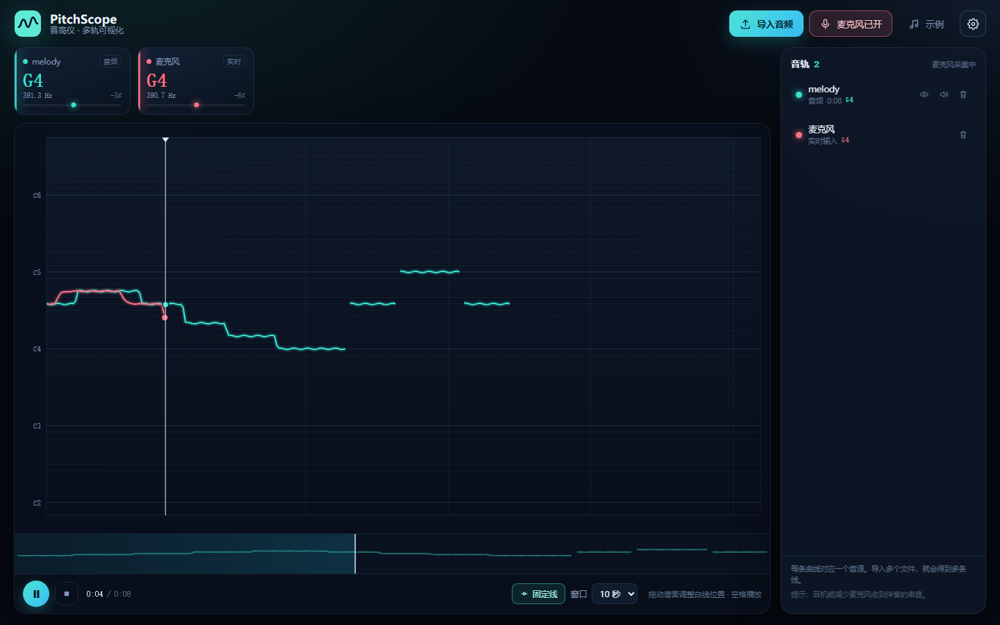
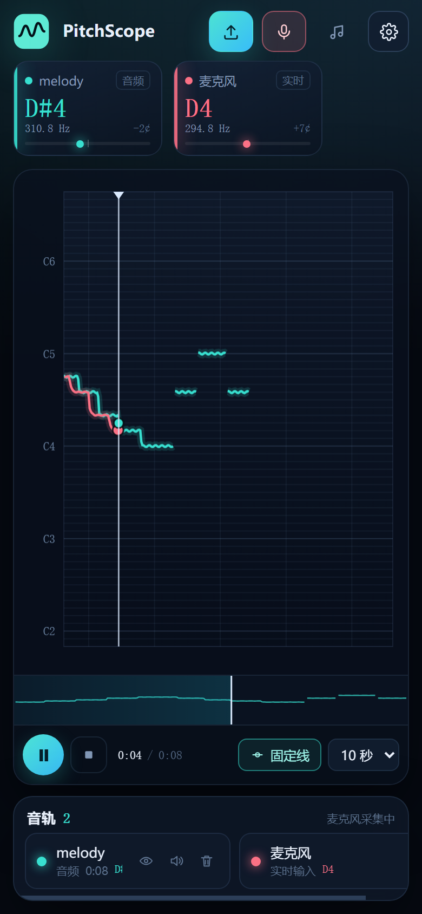
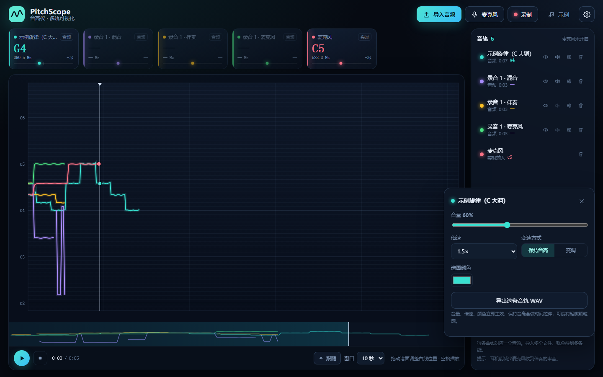
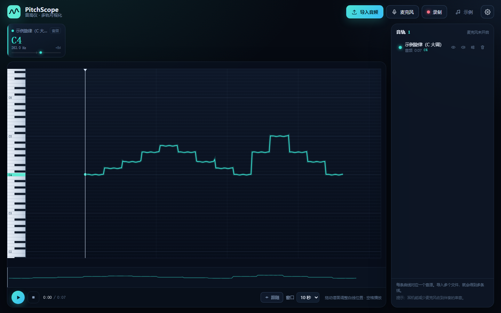

# PitchScope 音高仪

导入音频、打开麦克风，在**同一块屏幕**上同时看到多条音高曲线。纯静态网页，手机、平板、电脑的浏览器都能直接用。

**在线体验：** <https://YqV9N.github.io/pitchscope/>



## 功能

- **导入音频**：MP3 / WAV / M4A / OGG / FLAC，本地解码并提取音高曲线
- **实时麦克风**：可与音频播放同时进行，两条曲线按同一时间轴滚动
- **多条音轨**：多个文件 + 麦克风 = 多条彩色谱线，可单独显示、静音、移除
- **两种白线模式**：
  - **跟随**：白线固定在谱面左侧 1/6，谱面向左滚过；拖开谱面后可点「回到当前」
  - **固定线**：白线完全固定，拖谱面让时间在白线下滚过；拖白线只改它在屏幕上的位置
- **录制**：麦克风 + 正在播放的伴奏一起录，停止后自动生成「混音 / 伴奏 / 麦克风」三条独立音轨
- **分轨调节**：每条音轨可调音量、倍速（保持音高 / 变调）、谱线颜色，并导出 WAV
- **钢琴键盘**：谱面左侧的纵向琴键与音高轴对齐，点按或滑过即可试听
- **整曲缩略图**：点击跳转，拖动画布浏览
- **PWA**：可安装到主屏、离线打开

| 手机 | 分轨调节 | 钢琴键 |
| --- | --- | --- |
|  |  |  |

## 使用

1. 打开网页，点「导入音频」选择歌曲（可多选）
2. 点「麦克风」并允许权限
3. 点播放：音频曲线随播放滚动，你唱/奏的声音以另一条线实时叠加
4. 底部按钮切换「跟随 / 固定线」模式
5. 点「录制」开始录音，再点一次停止；会自动加入混音、伴奏、麦克风三条轨
6. 点音轨右侧的滑块按钮，调音量、倍速、颜色，或导出这条轨的 WAV
7. 左侧琴键可点按试听，按住上下滑动可连续弹奏

## 本地运行

麦克风需要安全上下文（HTTPS 或 localhost），不要直接双击 `index.html`：

```bash
python -m http.server 8080
```

然后访问 <http://localhost:8080>。

## 部署

纯静态站点，没有后端和构建步骤。仓库根目录的 `index.html` 就是入口，可直接用 GitHub Pages 托管：

- Settings → Pages → Deploy from a branch → `main` / `(root)`

也可以把文件拖到 Netlify Drop、Vercel、Cloudflare Pages。

> 修改 `js/`、`css/` 或 `index.html` 后，请把 `sw.js` 里的 `CACHE` 版本号加一，避免用户继续使用旧缓存。

## 实现

- 音高检测：**YIN**，用 FFT 自相关加速；文件重采样到 16 kHz 分析，麦克风用 AnalyserNode
- 音频播放：Web Audio API 多轨播放，每轨独立增益、倍速与音高保持
- 保持音高：离线 OLA 时间拉伸；变调：`playbackRate`
- 录制：`ScriptProcessor` 分别抓取麦克风与主输出，停止后合成混音
- 渲染：Canvas 2D，纵轴为 MIDI 音高（对数频率），左侧琴键与音高轴对齐
- PWA：Service Worker 缓存应用外壳

## 限制

- 每个音源只跟踪**一个基频**；和弦/钢琴复音不会自动拆成多条线（可导入分轨分别分析）
- 单个音频文件最长 10 分钟，单次录制最长 5 分钟
- 基准音高固定 A4 = 440 Hz
- 录制时建议戴耳机，避免伴奏串进麦克风
- 「保持音高」的时间拉伸在极端倍速下可能有轻微颗粒感

## 隐私

音频、录音和音高数据全部在浏览器本地处理，不会上传到任何服务器。

## License

[MIT](LICENSE)
